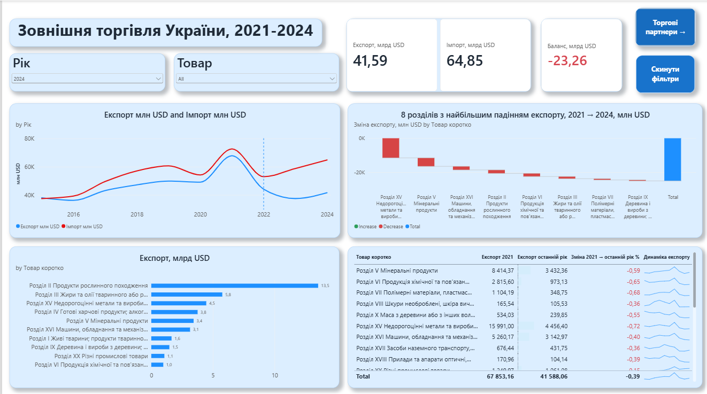
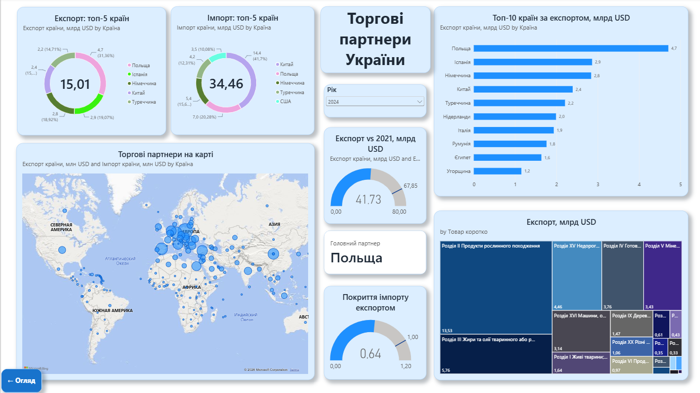

# Зовнішня торгівля України: що змінила війна (2021–2024)
Інтерактивний дашборд у Power BI про те, як змінилися експорт та імпорт товарів України, хто головний торговий партнер і які товарні розділи просіли найбільше.

## Головні висновки
- Експорт товарів у 2024 році склав **41,6 млрд USD** проти **67,9 млрд USD** у 2021 році, тобто приблизно на 39% менше.
- Імпорт у 2024 році: **64,9 млрд USD**, торговий баланс: **−23,3 млрд USD**.
- Найбільше падіння експорту - Недорогоцінні метали та вироби з них, Мінеральні продукти та Машини, обладнання та механізми.
- Головний ринок збуту у 2024 - Польща. У 2021 - Китай.

## Дані
- Джерело: [Держстат України, набір «Зовнішня торгівля товарами»](https://stat.gov.ua/uk/datasets/zovnishnya-torhivlya-tovaramy)
- Показник: вартість експорту та імпорту, тис. USD, річні дані
- Період: 2015–2024 у файлі, у дашборді акцент на 2021–2024
- Дата вивантаження: 22.10.2026

## Що зроблено
**Power Query**
- Розгорнула широку таблицю (по одній колонці на кожен рік) у довгий формат за допомогою Unpivot
- Відфільтрувала лише вартісні показники, прибрала колонки з примітками
- Перевела суми з тисяч USD у млн та млрд USD
- Додала допоміжні колонки: тип країни (країна / ЄС / весь світ), скорочена назва товару

**Модель та DAX**
- Одна таблиця фактів. Окремі міри для експорту, імпорту та балансу на двох рівнях деталізації (розділи товарів та групи для країн), щоб уникнути подвійного підрахунку
- Міри: зміна до 2021 року, частка країни, головний партнер, покриття імпорту експортом, динамічний заголовок періоду
- Умовне форматування (червоне/зелене), Top N фільтри, закладка для скидання фільтрів

**Візуалізація**
- Дві сторінки: «Огляд» та «Торгові партнери», навігація кнопками
- Лінійна діаграма, waterfall, донати, карта, treemap, таблиця зі спарклайнами, спідометри

## Обмеження даних
- З 2022 року дані наведено без урахування тимчасово окупованих територій. До 2021 року дані без Криму, Севастополя та частини Донецької і Луганської областей. Порівняння 2021 і 2022 не повністю коректне.
- Останні періоди можуть бути попередніми. Держстат уточнює дані.

## Файли
- `trade_ukraine_dashboard.pbix`: звіт Power BI Desktop

